# AdSelect: cuando los dólares del dashboard no llegan al bolsillo

## 1. Contexto: por qué considero que AdSelect era una estafa

En estos últimos días han aparecido plataformas que prometen hacernos «millonarios» con tareas sencillas. XenPaid ya había dejado a conocidos míos perdiendo el tiempo; después apareció AdSelect, con una propuesta demasiado familiar. En Cuba, donde la necesidad aprieta, una plataforma que promete dólares por mirar anuncios y traer amigos no necesita mucho para volverse popular.

AdSelect anunciaba **entre 3 y 5 dólares por ver anuncios** y **10 dólares por referido**, además de otras comisiones. Desde el primer momento me olió mal. Después de revisar sus dominios, inspeccionar el frontend, analizar su API y poner a prueba la lógica de referidos, mi valoración es clara: **considero que AdSelect seguía un patrón de estafa, no el de un negocio sostenible y confiable**.

No baso esa conclusión en un dominio recién registrado ni en que una página esté mal programada. Es la **combinación** de promesas de ingresos, cambios apresurados, controles deficientes, similitudes con XenPaid y, especialmente, la **caída de la plataforma en la fecha anunciada para retirar** lo que termina de dibujar el patrón.

> **Alcance y cronología:** el análisis técnico corresponde principalmente al **10 y 11 de noviembre de 2026**. Las pruebas del antiguo panel `/admin` se recuperaron de capturas de una versión anterior. La caída en el día previsto para los retiros es una observación posterior aportada para esta actualización; no se adjunta aquí un registro independiente de disponibilidad o una transacción de retiro fallida. Este artículo es mi evaluación técnica y crítica, no una identificación judicial de los operadores.

## 2. OSINT: dominios y huellas públicas

### 2.1. `adselect.net`

Consulté el historial de [Who.is para `adselect.net`](https://who.is/history/adselect.net) y el [buscador de ICANN](https://lookup.icann.org/). En la consulta aparecían estos datos:

| Campo | Valor observado |
| --- | --- |
| Titular | Oculto mediante un servicio de privacidad |
| Registrador | Namecheap |
| Creación del dominio | 7 de diciembre de 2003 |
| Última actualización | 9 de noviembre de 2026 |
| Vencimiento | 7 de diciembre de 2027 |
| Estados | `clientHold`, `clientTransferProhibited` |
| Servidores DNS | Cloudflare |

El dominio existía desde 2003, pero **eso no significa que AdSelect llevara operando desde entonces**. La actualización del 9 de noviembre, justo cuando la plataforma estaba en movimiento, llamó mi atención. Sospecho que el dominio pudo haber sido readquirido o reutilizado recientemente; **la fecha de actualización por sí sola no confirma una compraventa ni un cambio de titular**. Para demostrarlo haría falta un historial registral más completo.

Los servicios de privacidad y Cloudflare no son sospechosos por sí mismos. El estado `clientHold`, en cambio, sí puede afectar a la resolución del dominio. Visto junto a la rapidez de los cambios, el historial no transmitía estabilidad.

En las búsquedas aparecieron nombres parecidos, entre ellos `adselect.cc`. La semejanza del nombre tampoco prueba una relación. Para este segundo dominio encontré lo siguiente en las consultas de registro:

| Campo | Valor observado |
| --- | --- |
| Creación del dominio | 5 de noviembre de 2026 |
| Vencimiento | 5 de noviembre de 2027 |
| Titular | Oculto mediante PrivacyGuardian.org |
| Registrador | NameSilo, LLC |
| Servidores DNS | Cloudflare |
| Estado | `clientTransferProhibited` |

`adselect.cc` se había registrado apenas unos días antes de la revisión. No doy por hecha su relación operativa con los otros dominios, pero su aparición alrededor de las mismas fechas reforzó la necesidad de seguir el rastro de nombres y cambios.

### 2.2. Wayback Machine

Después revisé la [Wayback Machine](https://web.archive.org/) para entender cómo se veía el sitio antes de los cambios. La línea de tiempo y la primera captura ayudan a ubicar **qué versión** estamos analizando.

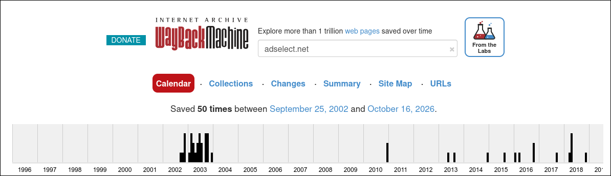

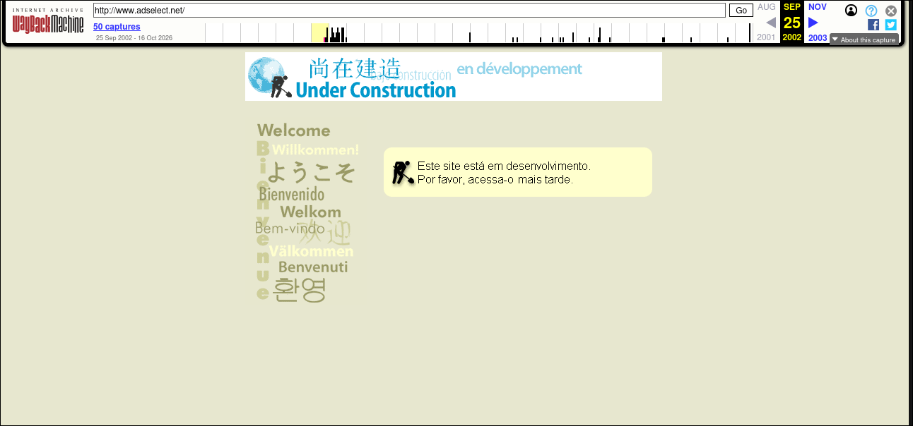

Esta era una de las vistas antiguas del panel:

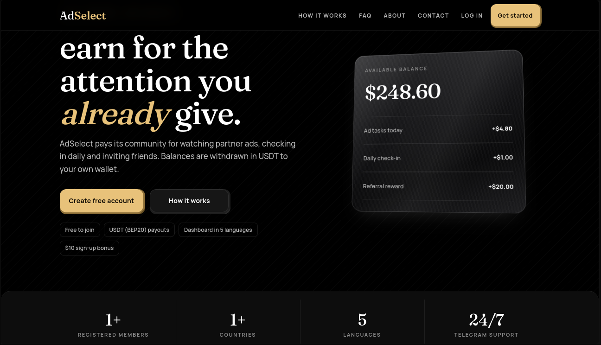

La comparación histórica importa porque **la antigüedad de un dominio no es la antigüedad de este negocio**. Y una captura bonita de un dashboard tampoco demuestra que alguien haya cobrado lo que marca el saldo.

## 3. Por dentro: un frontend que inspira poca confianza

Lo primero que me chocó del dashboard fue el **tremendo aire a vibecoding**: textos descuidados, detalles de interfaz inconsistentes y una experiencia que parecía construida a toda prisa. No puedo probar que se usara IA para escribir el código, ni sería un problema por sí mismo; mi crítica es que **una plataforma que dice administrar dinero debería demostrar bastante más rigor**. Pero bueno, pongámonos técnicos.

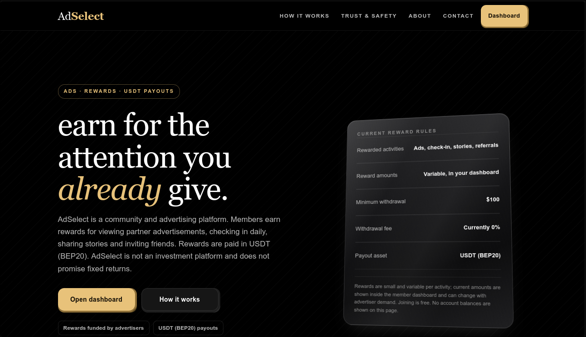

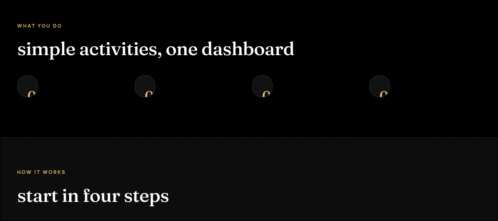

### 3.1. Tecnología observada

Al consultar `https://adselect.org/` con WhatWeb, la respuesta incluía `X-Powered-By: Next.js`, Cloudflare, el título de la página y la dirección `support@adselect.net`. El encabezado apunta a **Next.js**; no identifica por sí solo toda la arquitectura del servidor.

En la consola del navegador, `window.next?.version` devolvió `16.1.6` durante la revisión. Esa versión es una observación puntual: puede cambiar con cualquier despliegue.

### 3.2. Rutas en los archivos JavaScript

Next.js es un **framework de JavaScript**, no un lenguaje. El navegador recibe archivos JavaScript generados a partir del código de la aplicación. Aunque estén empaquetados y cueste leerlos, las rutas usadas por el frontend pueden aparecer allí.

Abrí las herramientas de desarrollo y busqué `/api` entre los archivos cargados. Esta es la vista desde la que inicié la búsqueda:

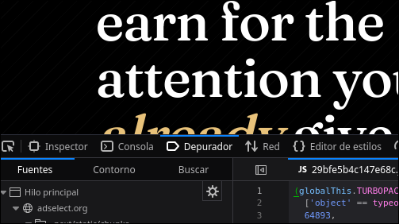

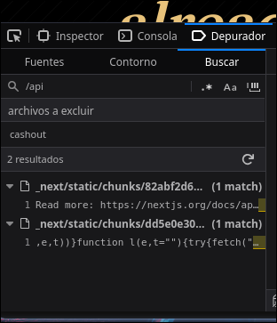

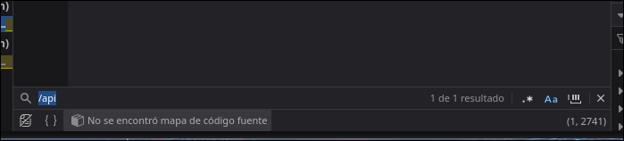

Desde `/login` y `/register` aparecieron estas rutas. También probé la enumeración automatizada con [JSRecon](https://github.com/js-recon/js-recon).

| Ruta encontrada | Función aparente |
| --- | --- |
| `/api/auth/forgot` | Recuperación de cuenta |
| `/api/auth/forgot-id` | Recuperación del identificador de usuario |
| `/api/auth/login` | Inicio de sesión |
| `/api/auth/me` | Consulta de sesión |
| `/api/auth/register` | Registro |
| `/api/auth/register-paid` | Registro asociado a pago |
| `/api/auth/register-paid/invoice` | Factura del registro de pago |
| `/api/auth/register-paid/proof` | Comprobante del registro de pago |
| `/api/auth/username-check` | Disponibilidad del nombre de usuario |
| `/api/brand` | Datos de marca o configuración |
| `/api/checkout/status` | Estado del proceso de cobro o retiro |
| `/api/pixel-log` | Registro de eventos |
| `/api/public/registration-mode` | Modo de registro |
| `/api/public/sponsor` | Datos del patrocinador |

La exposición de rutas no es automáticamente una vulnerabilidad; sí ayuda a reconstruir cómo trabaja el sistema. Días antes, `/admin` también revelaba parte de la lógica de la vista administrativa, que recupero a continuación porque ilustra **el contraste entre la apariencia de plataforma financiera y lo improvisado de algunas decisiones del frontend**. Vale la pena recuperar aquella observación porque ayuda a entender cómo estaba construida la interfaz original.

### 3.3. El antiguo panel de administración: una fachada alterable

> **Nota sobre la evidencia histórica:** lo que sigue reconstruye una prueba realizada contra una versión anterior de AdSelect a partir de notas y capturas conservadas. **Ese comportamiento ya no estaba disponible para repetirlo durante la revisión posterior**, después de los cambios del sitio. Por tanto, esta sección explica cómo funcionaba la interfaz en aquel momento, no cómo funciona la plataforma actualmente. Las capturas enlazadas documentan la prueba original; no deben interpretarse como evidencia de acceso administrativo vigente.

Al revisar los archivos JavaScript observé una ruta `/admin` y una lógica de comprobación de sesión. Según la versión analizada, la interfaz consultaba el endpoint de sesión —identificado en la enumeración como `/api/auth/me`— y utilizaba el campo `role` para decidir qué pantalla mostrar. Si el usuario no tenía el rol esperado, el navegador terminaba redirigiéndolo fuera de la vista administrativa.

Había un detalle interesante: **el código de esa pantalla llegaba al navegador antes de que se completara la decisión de redirección**. Eso permitía estudiar la interfaz sin necesidad de demostrar que el servidor concediera permisos de administrador.

Para comprobarlo utilicé la función **Match and Replace de Burp Suite**, que permite sustituir partes de las respuestas HTTP mientras pasan por el proxy. En esta prueba, el objetivo no era modificar la cuenta en el servidor, sino observar qué ocurría cuando el frontend recibía una respuesta de sesión con un valor diferente en el campo del rol.

El flujo fue el siguiente:

1. Accedí a la ruta `/admin` con una sesión ordinaria.
2. La aplicación consultó los datos de la sesión y la respuesta indicaba el rol `member`.
3. Configuré Match and Replace para que, en la respuesta entregada al navegador, el valor del rol apareciera como `admin`.
4. Al recibir esa respuesta modificada, el frontend permitió visualizar la pantalla administrativa que anteriormente no llegaba a mostrarse de forma estable.

Esta es la configuración de sustitución conservada de aquella prueba:

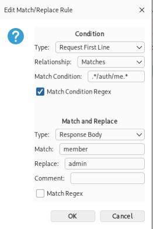

Para comparar lo ocurrido, primero está la respuesta **sin modificar**, con el rol original:

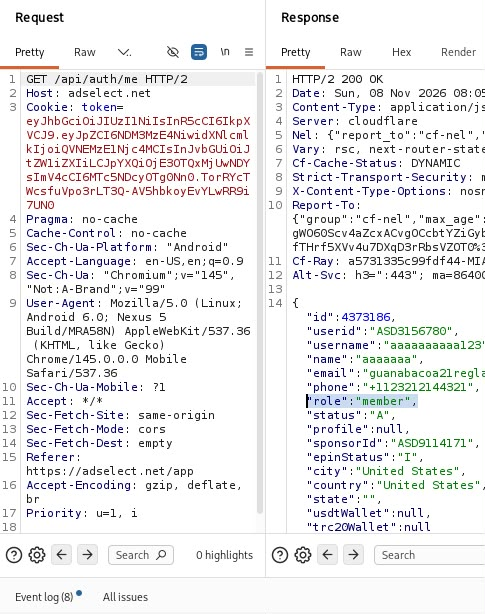

Y después la respuesta **modificada localmente** por el proxy:

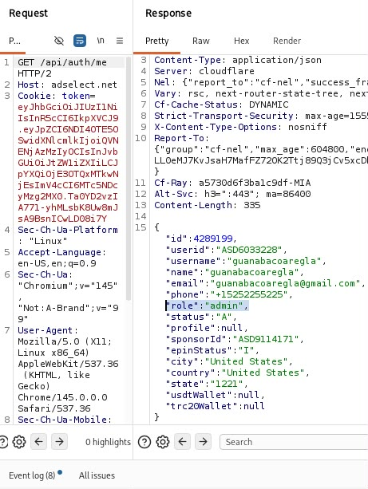

El resultado fue esta vista del antiguo dashboard de administración:

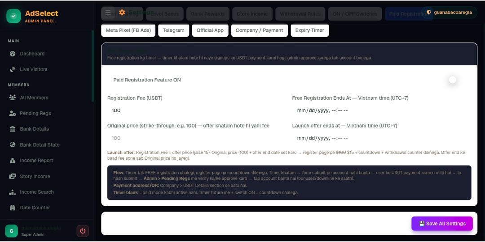

Aquí está la distinción clave: **pude visualizar una pantalla administrativa, pero no acceder a sus funcionalidades privilegiadas**. El cambio se realizó sobre la respuesta que veía el navegador; no hay evidencia de que se alterara el rol almacenado en el servidor ni de que las API administrativas aceptaran operaciones no autorizadas.

El resultado deja en evidencia una decisión de diseño poco cuidada: **la visualización del panel dependía de un valor controlable en la respuesta recibida por el navegador**. No obtuve acceso real a funciones administrativas ni demostré escalada de privilegios; el backend podía conservar sus propias comprobaciones. Pero exhibir así una consola interna no es precisamente lo que esperaba de una plataforma que pretendía gestionar saldos y pagos.

#### 3.3.1. Los textos del panel: otra señal de improvisación

Dentro de aquella vista encontré expresiones en inglés poco naturales y giros que me recordaron al inglés utilizado en la India. Conservo las capturas porque forman parte de la investigación histórica y muestran el **escaso cuidado editorial y la falta de coherencia lingüística** de esa interfaz.

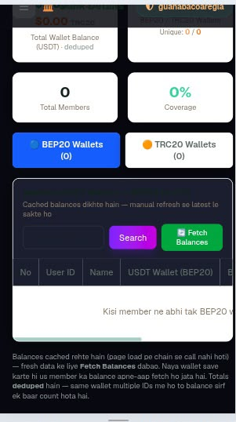

No voy a atribuir la estafa a personas de una nacionalidad determinada: **escribir en inglés con rasgos regionales no demuestra quién creó el sitio ni que su autor sea un estafador**. La crítica relevante es otra: había textos extraños, una interfaz administrativa expuesta en el cliente y señales de un producto ensamblado con poca revisión.

La versión de la que salen estas capturas **ya no estaba accesible en la revisión posterior**. Por eso las presento como evidencia histórica de cómo se veía la aplicación, no como una vulnerabilidad vigente.

## 4. Análisis activo: controles débiles en una plataforma que promete dinero

Al observar las solicitudes en Burp Suite aparecieron tres comportamientos preocupantes. En un sitio que gestiona cuentas y supuestas recompensas, **los controles de negocio importan tanto como los de seguridad**:

1. **Recuperación de contraseña.** El flujo parecía pedir correo y número de teléfono para cambiar la contraseña. Si ambos datos bastan y no hay una verificación adicional, podría existir un problema de toma de cuentas. La captura muestra el flujo observado, pero no prueba por sí sola que se pueda tomar una cuenta ajena.

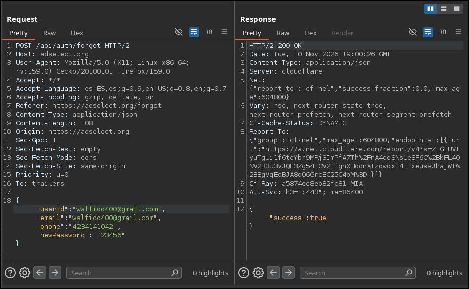

2. **Recuperación del identificador.** La respuesta de `forgot-id` parecía revelar datos parcialmente ocultos. El riesgo depende de qué campos se puedan consultar, cuántas consultas admite y cuánta información deja reconstruir.

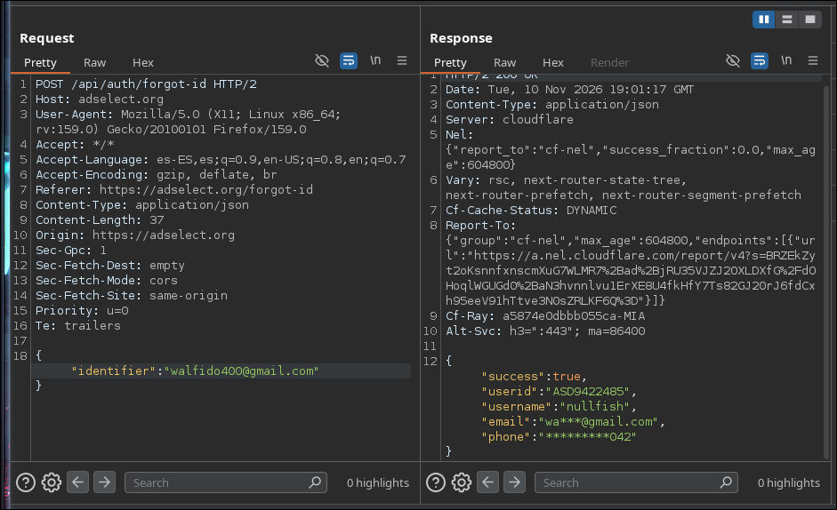

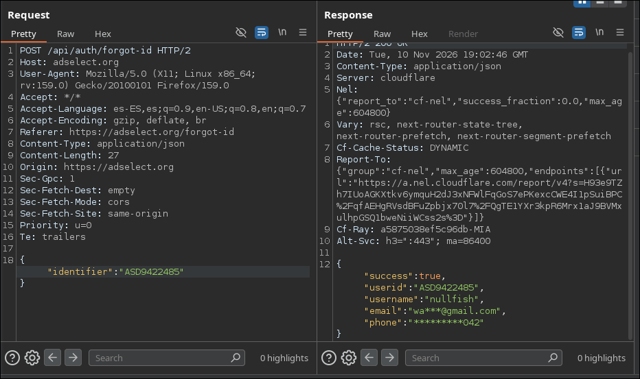

3. **Registro y referidos.** El formulario permitía repetir solicitudes de registro. Si el sistema acredita bonos por cuentas ficticias sin controles suficientes, el contador de ingresos podría inflarse. La limitación de Cloudflare reduce la velocidad de las solicitudes; no valida que cada cuenta corresponda a una persona distinta.

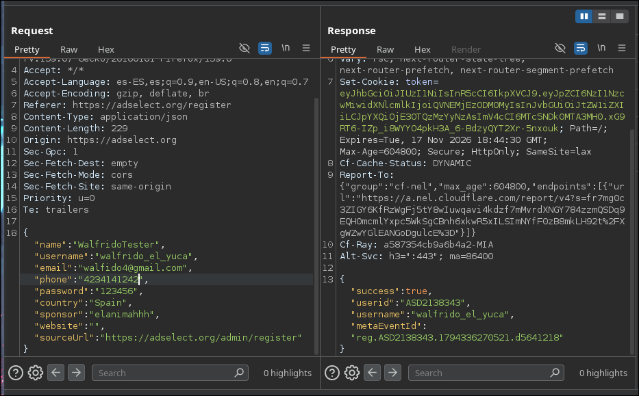

## 5. Prueba de concepto: fabricar saldo es fácil, cobrarlo es otra historia

Para explorar el caso de los referidos utilicé [M.A.C.A.C.O](https://github.com/RojoFW/M.A.C.A.C.O), una herramienta que desarrollé para repetir solicitudes POST a partir de una plantilla. La idea era comprobar si el panel acreditaba bonos al crear cuentas asociadas a un mismo patrocinador.

La captura siguiente muestra el **saldo que presentó la interfaz** después de la prueba:

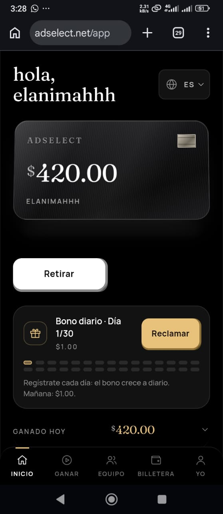

Y listo, ¿tenemos **470 dólares**? Jeje... si realmente fuese tan fácil. **Solo faltaría «retirarlos».**

Esa fue precisamente la parte más reveladora: el sistema podía mostrar recompensas originadas por registros repetidos, pero **un saldo en una base de datos no equivale a dinero disponible ni a un retiro real**. La prueba muestra una debilidad aparente en el cómputo de referidos; no demuestra que se completara un cobro y tampoco permite saber si el backend anularía después esos registros.

Aun con esa limitación, el resultado es grave desde el punto de vista de la confianza: si una plataforma promete pagos por referidos, **debería validar seriamente a quién recompensa**. Aquí la cifra del dashboard crecía mucho más fácilmente de lo que se podía verificar su legitimidad.

## 6. La similitud con XenPaid: el mismo libreto

El parecido visual y funcional con **XenPaid**, una plataforma anterior que ya no estaba disponible durante mi revisión, fue otra alarma. Mi impresión es que AdSelect retomaba el mismo libreto: anuncios, recompensas, referidos y la expectativa de acumular dinero que supuestamente se podría retirar después.

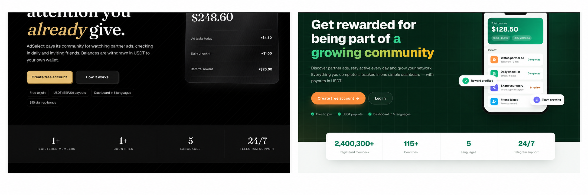

No necesito afirmar que los dos sitios pertenecían a las mismas personas para considerarlo relevante. Mi crítica va al **modelo que se repetía** y a la ausencia de una explicación convincente sobre la procedencia del dinero que se prometía repartir.

## 7. Cambios de dominio y caída en el día del retiro

Mientras preparaba la investigación dejé de poder acceder a `adselect.net` y encontré la página en `adselect.org`. El registro de `.org` indicaba creación y actualización el **10 de noviembre de 2026 a las 02:53 UTC**, con Namecheap como registrador, Cloudflare como DNS y estados `clientTransferProhibited` y `addPeriod`.

El **11 de noviembre** la página ya había cambiado drásticamente y parecía estar montada en WordPress. Pasar de la versión inspeccionada con Next.js a otra presentación, al mismo tiempo que se cambiaban dominios, no proyectaba precisamente estabilidad.

Pero para mí la señal decisiva llegó después: **según lo observado, AdSelect dejó de funcionar justamente el día previsto, (Hoy 12 de noviembre) para los retiros**. Durante la etapa de acumulación de supuestas ganancias, el saldo estaba ahí para generar expectativas; cuando tocaba comprobar que esos números se podían convertir en dinero, la plataforma ya no estaba disponible.

Ese desenlace **encaja con un patrón de fraude por recompensas ficticias**: se atraen usuarios con ganancias aparentes, se incentivan los referidos y el sistema deja de responder cuando llega el momento de pagar. En este artículo no presento una prueba de transferencia fallida ni registros técnicos de disponibilidad de esa fecha; describo la caída reportada y explico por qué, unida al resto de hallazgos, pesa tanto en mi valoración.

## 8. Conclusión: mi veredicto sobre AdSelect

**Para mí, AdSelect fue una estafa.** No llego a esa conclusión por una frase mal traducida, porque use Next.js o porque el dominio tenga privacidad. Llego por la acumulación de hechos y observaciones:

1. **Dominios e infraestructura inestables.** Un dominio antiguo actualizado recientemente, otro recién registrado y una migración visible en cuestión de días. La supuesta readquisición de `adselect.net` es una hipótesis, no un hecho demostrado.
2. **Lógica de negocio floja.** Los flujos de recuperación, registro y referidos mostraron deficiencias o condiciones que justificaban una seria desconfianza para una plataforma que decía manejar dinero.
3. **Producto improvisado.** Interfaz inconsistente, panel administrativo que se podía visualizar cambiando una respuesta en el navegador y similitudes llamativas con XenPaid; esto último no demuestra operadores compartidos.
4. **Ganancias que existían, sobre todo, en pantalla.** La prueba de referidos permitió ver crecer el saldo aparente sin documentar un retiro efectivo.
5. **El momento del desplome.** La plataforma dejó de estar disponible, según la observación recogida, precisamente cuando correspondía comprobar los retiros.

